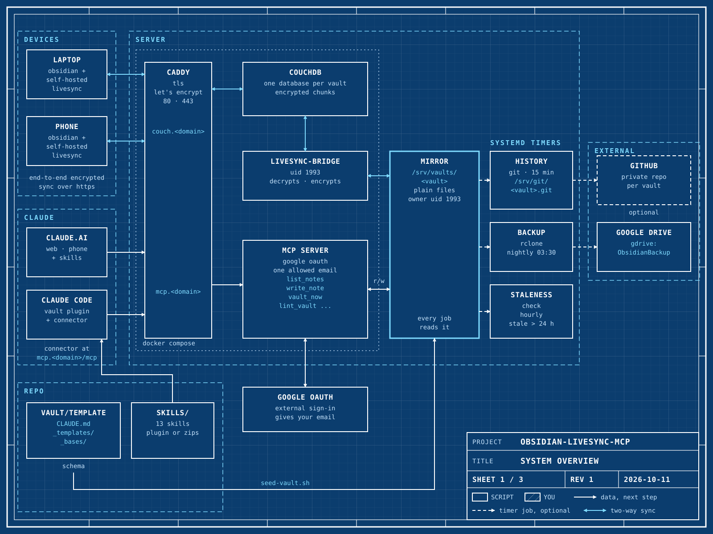

# Obsidian knowledge vault: self-hosted sync, schema, and Claude skills

> **Start here: [docs/quickstart.md](docs/quickstart.md).** It takes you from
> an empty server to a first note that Claude writes, in eight steps.

This repository gives you a knowledge vault that you own. Claude can read and
write it from claude.ai on the web and the phone, and from Claude Code. The
repository has three parts. Each part needs the other two, so they stay
together.



| Part | What it is | Start here |
|---|---|---|
| [`backend/`](backend) | Self-hosted sync for Obsidian (CouchDB + LiveSync), a plain-file mirror on the server, git history, Drive backup, and an MCP server that gives Claude access | [`backend/README.md`](backend/README.md) |
| [`vault/`](vault) | The vault schema: folder layout, note types, frontmatter, templates, dashboards, and worked examples | [`vault/README.md`](vault/README.md) |
| [`skills/`](skills) | Claude skills that capture, synthesize and lint notes as the schema tells them, on Claude Code and claude.ai | [`skills/README.md`](skills/README.md) |

## How the parts fit

- The **backend** moves files between your devices, the mirror on the server,
  and Claude.
- `seed-vault.sh` copies the **schema** from `vault/template` into each vault.
  The schema is the root `CLAUDE.md`, the templates in `_templates` and the
  dashboards in `_bases`. Every note follows it.
- The **skills** tell Claude how to work inside the schema. A skill decides
  the note type of a piece of information and where it goes.
- A skill also tells Claude what to confirm before it writes.
- The MCP server adds two tools for the skills: `vault_now` for UTC timestamps
  and `lint_vault` for structural checks.

The skills also work on a local folder without the backend. Read
[`vault/README.md`](vault/README.md).

## Setup order

The main path is the [quick start](docs/quickstart.md). It uses two scripts
in `backend/scripts/`:

- `bootstrap.sh` sets up the backend on a new server, with no vault. It asks
  only for the values that `.env` does not have. You can run it again.
- `doctor.sh` checks a running install. It changes nothing.

The order of the setup is:

1. **Backend:** run `sudo ./scripts/bootstrap.sh`. For the manual reference,
   read [`backend/docs/setup.md`](backend/docs/setup.md).
2. **A vault:** run `add-vault.sh`. It offers to put the schema in with
   `seed-vault.sh`. Read [`backend/docs/vaults.md`](backend/docs/vaults.md).
3. **Devices:** read [`backend/docs/onboarding.md`](backend/docs/onboarding.md).
   Then set the two Obsidian settings for each device in
   [`vault/README.md`](vault/README.md).
4. **Skills:** read [`skills/README.md`](skills/README.md), for Claude Code and
   claude.ai.

## Tests

```bash
python backend/mcp/test_vaults.py        # MCP path sandbox
python backend/mcp/test_lint.py          # lint on the template and examples (needs PyYAML)
python3 skills/tools/build.py check      # skills valid and self-contained
```

This repository holds configuration, the schema and code only. **Vault content
does not go into this repository.**
