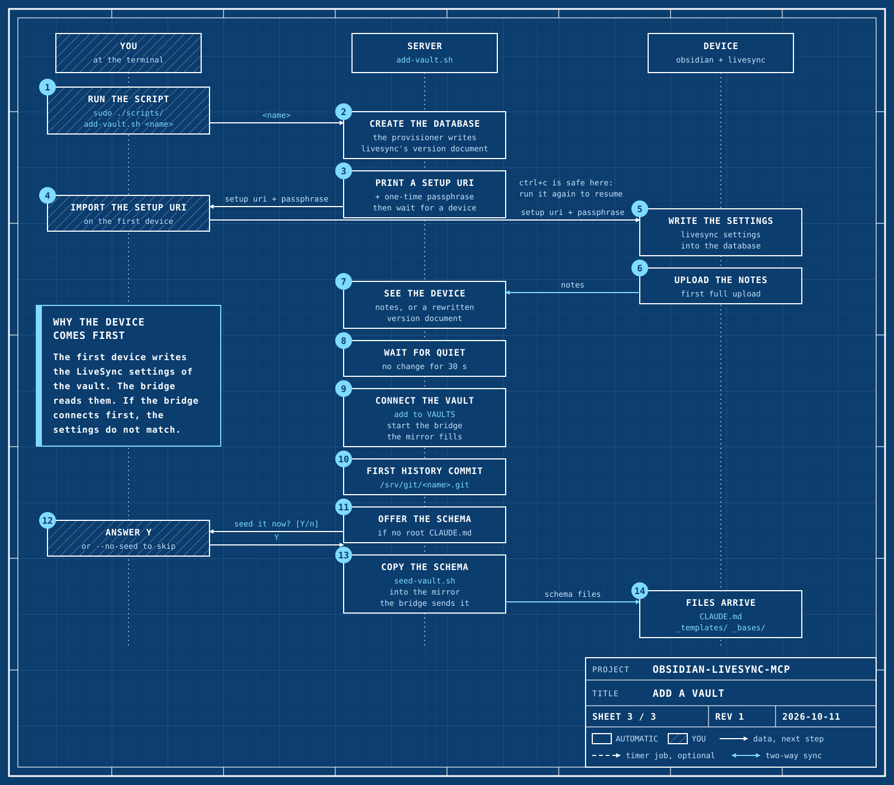

# Add and remove vaults

The backend runs with no vaults. You add the vaults one at a time. The steps
are the same for new notes and for existing notes.

## Add a vault



`add-vault.sh` does all of the work in one run:

1. It makes the database and prints a Setup URI.
2. It waits while you connect the first device.
3. When the upload of that device is complete, it connects the vault to the
   server.
4. It offers to seed the knowledge vault schema.

```bash
sudo ./scripts/add-vault.sh <name>      # 1-3. database, first device, connect
sudo ./scripts/seed-vault.sh <name>     # 4. new vault: puts the schema in
```

The second command is necessary only if you do not accept the offer in step 4.

| Flag | What it does |
|---|---|
| (none) | Set up, wait, connect, offer the schema. |
| `--no-wait` | Set up and print the URI only. Then stop. |
| `--no-seed` | Do not offer the schema. Print the `seed-vault.sh` command. |

A name can have letters, digits, `.`, `_` and `-`. It must not start with
`.`. The script uses the name for the CouchDB database, the folder
`/srv/vaults/<name>` and the history repository. If the GitHub push is on, it
also uses the name for the GitHub repository.

### 1. The database and a Setup URI

**SCRIPT:** `add-vault.sh` makes the CouchDB database of the vault. It prints
a Setup URI and its one-time passphrase for the first device.

Nothing else changes yet. The vault is not in `VAULTS`, so the bridge and
the timers do not see it. You do not need to keep the text that it prints.
[`onboarding.md`](onboarding.md) tells why.

Then the script waits and watches the database. Keep it open while you do
step 2.

### 2. Connect the first device

**YOU:** on a desktop, follow [`onboarding.md`](onboarding.md) for the first
device. Import the Setup URI from step 1. Do not set up LiveSync by hand. The
only difference between new and existing notes is the folder that you open in
Obsidian:

| Notes | Folder to open |
|---|---|
| **New vault** | Make an empty vault in Obsidian. |
| **Existing notes** | Open the folder of that vault. If it is in Google Drive, first follow [`migration.md`](migration.md) to copy it out of Drive. |

Let the first upload finish completely.

The order is important. The first device writes the LiveSync settings of the
database. The bridge reads them when it connects. If the bridge connects
first, the settings do not agree. That is why `add-vault.sh` waits.

### 3. Connect the vault to the server

**SCRIPT:** when the first device connects, `add-vault.sh` shows the number
of documents. It then waits until the upload is quiet: no change for 30
seconds. Then, in the same run, it does these steps:

1. If `GIT_PUSH=github`, it makes the private GitHub repository, or uses an
   existing one. It tells you before it makes a repository.
2. It adds the name to `VAULTS` in `.env`.
3. It makes `/srv/vaults/<name>`, owned by uid 1993 of the containers.
4. It writes `bridge/config.json` again and starts or restarts the bridge.
5. It waits for the notes to come into `/srv/vaults/<name>`.
6. It makes the first history commit. If the GitHub push is on, it pushes it.

After this, Claude can see the vault. The git, backup and staleness timers
include it. A new empty vault makes the staleness check show a warning until
the vault has a note. That is the expected result.

### If you stop the wait

You can stop the wait with Ctrl+C at any time. At that point, only the
database exists. To continue, run the same command again:

| State when you run it again | What the script does |
|---|---|
| No device connected | It prints a new URI and waits again. |
| The first device connected | It checks for 30 seconds that no upload continues, then connects the vault. |

If no device connects in one hour, the script stops itself. It gives the
same instruction: run the command again.

For automation, `--no-wait` keeps the old behavior: it prints the URI and
stops. When the first upload is complete, run
`sudo ./scripts/add-vault.sh <name>` again. That run connects the vault. If
you run it before the device connects, it prints a new URI.

### 4. Seed the schema

A new vault is empty. At the end of the run, if the vault has no root
`CLAUDE.md`, `add-vault.sh` asks:

```text
Seed the knowledge vault schema now? [Y/n]
```

| Answer | Result |
|---|---|
| Enter or `Y` | The script runs `seed-vault.sh` for the vault. |
| `n` | The script prints the command to seed later. |

The script does not ask with `--no-seed`, or if no terminal is connected to
its input. It prints the command instead. To seed later, run:

```bash
sudo ./scripts/seed-vault.sh <name>
```

`seed-vault.sh` copies `vault/template` from this repository into the vault
folder. The copy has the root `CLAUDE.md` (the schema), `README.md`,
`log.md`, `_templates/` and `_bases/`. The bridge pushes the files out, and
the first device receives them in a few seconds.

`seed-vault.sh` refuses to run on a vault that has a root `CLAUDE.md`. It
also refuses to overwrite a file. Thus you can safely try it on a vault that
has notes.

When the schema in this repository changes, update the copy in a vault:

```bash
sudo ./scripts/seed-vault.sh <name> --upgrade
```

`--upgrade` replaces only the root `CLAUDE.md`, `_templates/` and `_bases/`.
It does not change the areas, `log.md`, `README.md` or the current-area
marker. It commits history before and after, so you can restore the old files
from git.

[`vault/README.md`](../../vault/README.md) explains the schema and the
Obsidian settings for each device.

### 5. Other devices

**YOU:** connect the other devices with a new Setup URI from the first device
([`onboarding.md`](onboarding.md)). They must download, not upload.

If you run `add-vault.sh` on a vault that you added before, it only checks
each step again. Use this to give existing vaults their GitHub repositories
after you turn on the GitHub push.

## Remove a vault

```bash
sudo ./scripts/remove-vault.sh <name>            # archive, delete nothing
sudo ./scripts/remove-vault.sh <name> --purge    # also delete the database
```

The script asks you to type the vault name. Then it does these steps:

| Step | What happens |
|---|---|
| Final snapshot | It commits the current state of the vault to history. If the GitHub push is on, it pushes. |
| Disconnect | It removes the vault from `VAULTS` and writes the bridge configuration again. It restarts the bridge, or stops it if no vaults remain. |
| Park the files | It moves `/srv/vaults/<name>` to `/srv/vaults-removed/<name>-<timestamp>/`. Claude cannot see it there. |
| Keep | It does not touch `/srv/git/<name>.git` and the GitHub repository. |
| CouchDB database | It keeps the database. With `--purge`, it asks again and deletes it. You cannot undo this. |

The script disconnects the bridge **before** it moves the folder. A bridge
that watches the folder sees the move as "every note deleted". It then sends
that deletion to all devices.

Then do these steps by hand:

1. On each device, disable Self-hosted LiveSync for that vault, or delete the
   local vault. A device that continues to sync makes the vault again in
   CouchDB.
2. For Google Drive, do nothing. The next nightly backup moves the copy of
   the vault into the dated `ObsidianBackup-replaced/` folder.

### Bring a removed vault back

Move the parked folder back, then add the vault as usual:

```bash
sudo mv /srv/vaults-removed/<name>-<timestamp> /srv/vaults/<name>
sudo ./scripts/add-vault.sh <name>
```

If you kept the database, it still holds the notes. Then `add-vault.sh`
prints no Setup URI. It checks for 30 seconds that no upload continues. Then
it connects the vault.

`add-vault.sh` refuses to add a vault again while its files are still
parked. Thus the bridge does not start from an empty folder that it remembers
as full. To start again from nothing, delete the parked folder first. Also
use `--purge` when you remove the vault, so that the old database goes too.
