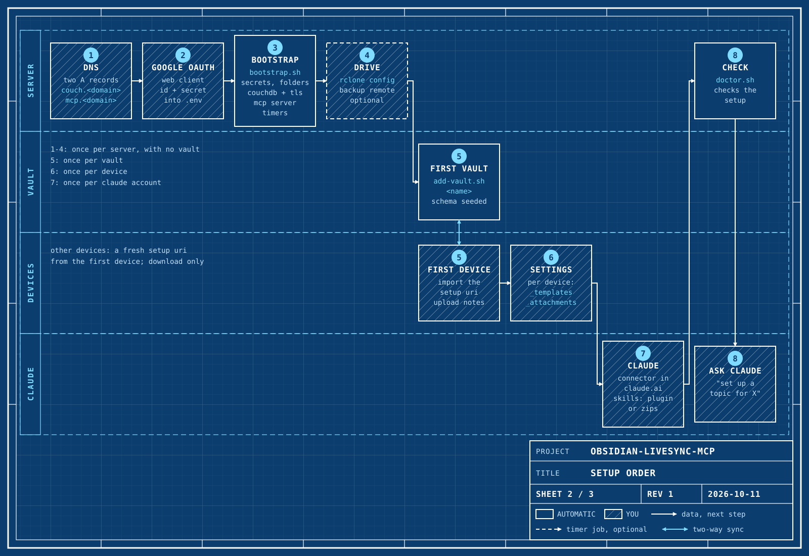

# Quick start

This guide takes you from an empty server to a first note that Claude writes
into your vault.

## What you get

You get an Obsidian vault that syncs to all your devices through your own
server. The sync is end-to-end encrypted. The server keeps a plain-file mirror
of the vault, a git history and a nightly backup to Google Drive. Claude reads
and writes the mirror through the MCP server, from claude.ai and from Claude
Code. The skills tell Claude where each note goes.


## Before you start

Make sure that you have these items:

- [ ] A VPS with Ubuntu (we test on 24.04), root access, and ports 80 and 443 open.
- [ ] A domain that you control.
- [ ] A Google account.
- [ ] Obsidian on your devices.
- [ ] A claude.ai account.
- [ ] A password manager.
- [ ] About 45 minutes.

## Setup steps

The steps have the same numbers as sheet 2. The **YOU** label means that you
do the step by hand. The **SCRIPT** label means that a script does it.



| Steps | How often |
|---|---|
| 1 to 4 | One time for each server, with no vault |
| 5 | One time for each vault |
| 6 | One time for each device |
| 7 | One time for each Claude account |

### 1. DNS (YOU)

**Do this:** At your DNS provider, add two A records. Both records point to the
IPv4 address of the server.

| Name | Type | Value |
|---|---|---|
| `couch.<domain>` | A | The IPv4 address of the server |
| `mcp.<domain>` | A | The IPv4 address of the server |

CouchDB must be at the root of its own subdomain. Do not put it under a path.

**Result:** `dig +short couch.<domain>` and `dig +short mcp.<domain>` show the
address of the server.

**If it fails:** Wait some minutes for DNS to update. Then do the check again.
In step 3, `bootstrap.sh` also checks the two names.

### 2. Google OAuth client (YOU)

The MCP server uses Google sign-in. Only one Google account gets access.

**Do this:** Open the [Google Cloud Console](https://console.cloud.google.com/auth/overview).
Go to **Google Auth Platform**. Then do these steps:

1. Click **Overview → Get started**. Type an app name and your email.
2. Set **Audience** to **External**. Accept the policy and click **Create**.
3. Go to **Audience → Test users → Add users**. Add your own Google address.
4. Go to **Clients → Create client**. Select **Web application**.
5. Add this authorized redirect URI, exactly: `https://mcp.<domain>/auth/callback`.
6. Click **Create**. Copy the client ID and the client secret into your password manager.
7. Go to **Audience** and click **Publish app**. Then Google does not ask you to sign in again each week.

**Result:** You have a client ID and a client secret. Step 3 asks for them.

**If it fails:** Read [setup.md, section 7](../backend/docs/setup.md).
The Console can show the secret in full only one time. If you lost it, add a
new secret to the client.

### 3. Server (SCRIPT)

**Do this:** Connect to the server with SSH. Then do these steps:

1. Install the tools as root: Docker, Deno 2, rclone and git. Root must own the Deno install.

   ```bash
   sudo -i
   curl -fsSL https://get.docker.com | sh
   curl -fsSL https://deno.land/install.sh | sh
   apt-get install -y rclone git jq openssl curl python3 python3-cryptography
   exit
   ```

2. Get the repository.

   ```bash
   sudo git clone https://github.com/elk-cloner/obsidian-livesync-mcp.git /opt/obsidian-self-host
   cd /opt/obsidian-self-host/backend
   ```

3. Run the bootstrap script.

   ```bash
   sudo ./scripts/bootstrap.sh
   ```

The script first checks the tools. If a tool is missing, it shows the install
command and stops. Install the tool and run the script again.

Then the script asks for these values:

| Question | Your answer |
|---|---|
| Domain | Your domain, for example `notes.example.org` |
| Email for Let's Encrypt | An email for certificate notices |
| Your Google account email | The Google account that Claude signs in with |
| Google client ID | The client ID from step 2 |
| Google client secret | The client secret from step 2 (the script hides it) |
| rclone remote for the nightly backup | Push Enter to keep `gdrive` |
| Generate one (g) or type your own (t)? | `g` makes a passphrase, `t` lets you type one |

The passphrase encrypts all your notes. Nothing can recover your notes without
it. Store the passphrase in your password manager. Then type `saved`.

Then the script does these tasks:

- It writes the secrets to `backend/.env`.
- It checks DNS and creates the folders.
- It starts CouchDB and Caddy and waits for the TLS certificate.
- It writes the bridge config and starts the MCP server.
- It installs the timers and runs `doctor.sh`.

**Result:** The script shows `All checks passed`. A warning about the backup
remote is correct until you do step 4.

**If it fails:** Read the message, correct the problem, and run
`sudo ./scripts/bootstrap.sh` again. The script skips the steps that are
complete. To see what it does without a change, run
`sudo ./scripts/bootstrap.sh --dry-run`.

### 4. Drive backup (YOU, optional)

The backup copies every mirror to Google Drive each night. The other parts work
without it.

**Do this:** On the server, configure an rclone remote with the name that you
gave in step 3 (`RCLONE_REMOTE`, default `gdrive`).

1. Run `sudo rclone config`.
2. Make a new remote with that name and the type `drive`.
3. Use the headless flow. Paste the token from a browser on your computer.
4. Check the remote. If your remote has a different name, use it in place of `gdrive`.

   ```bash
   sudo rclone lsd gdrive:
   ```

**Result:** `rclone lsd` shows the folders of your Drive.

**If it fails:** Use `sudo` for each rclone command. The backup timer runs as
root and uses the rclone config of root.

### 5. First vault (SCRIPT and YOU)


The first device must connect before the bridge. The first device writes the
LiveSync settings of the vault, and the bridge reads them.

**Do this:** On the server, run the script with a name for the vault.

```bash
sudo ./scripts/add-vault.sh <name>
```

The script prints a Setup URI and a passphrase. Then it waits. Keep the
terminal open.

Do not paste the Setup URI or the passphrase anywhere other than Obsidian. The
Setup URI expires, so use it now.

On your desktop computer, do these steps:

1. In Obsidian, create an empty vault.
2. Go to **Settings → Community plugins → Browse**. Install and enable **Self-hosted LiveSync**.
3. Copy the full Setup URI from the terminal. It starts with `obsidian://setuplivesync?settings=`.
4. Push Cmd+P (macOS) or Ctrl+P. Run **Self-hosted LiveSync: Use the copied setup URI**.
5. Paste the Setup URI if Obsidian asks for it. Then type the passphrase.
6. When LiveSync asks, select that this is the first device, or "set up as new".
7. When LiveSync asks about Hidden File Sync, select **No**.
8. If LiveSync asks about the ID key or a configuration mismatch, select **Keep current configuration**.

Older LiveSync versions name the command **Open setup URI**. You can also use
the setup wizard tab in the plugin settings.

The script sees the device and waits until the upload is quiet for 30 seconds.
Then it connects the vault to the server. At the end, it asks
`Seed the knowledge vault schema now? [Y/n]`. Type `Y`.

**Result:** `CLAUDE.md`, `README.md`, `log.md`, `_templates/` and `_bases/`
appear in Obsidian.

**If it fails:** If you stopped the script with Ctrl+C, run the same command
again. It continues from where it stopped. To seed the schema later, run
`sudo ./scripts/seed-vault.sh <name>`. For more, read [vaults.md](../backend/docs/vaults.md).

### 6. Obsidian settings (YOU)

Obsidian settings do not sync. Do this step on each device.

**Do this:**

1. Go to **Settings → Core plugins**. Turn on **Templates**.
2. In the **Templates** settings, set **Template folder location** to `_templates`.
3. Go to **Settings → Files and links → Default location for new attachments**.
4. Select **In the folder specified below**. Type `_attachments`.

**Result:** A new template note and a new attachment go to the correct folders.

**If it fails:** Read [vault/README.md](../vault/README.md).

### 7. Claude (YOU)

**Do this:** First add the connector:

1. In claude.ai, go to **Customize → Connectors**.
2. Click **+ → Add custom connector**.
3. Type the URL `https://mcp.<domain>/mcp`.
4. Sign in with the Google account from step 3.

Claude Code also uses the claude.ai connectors.

Then install the skills. For Claude Code, run these commands:

```bash
claude plugin marketplace add elk-cloner/obsidian-livesync-mcp
claude plugin install vault@obsidian-livesync-mcp
```

For claude.ai, do these steps:

1. Go to **Settings → Capabilities → Skills**. Remove your old `vault-*` skills.
2. Download the zips from the [latest release](https://github.com/elk-cloner/obsidian-livesync-mcp/releases/latest).
3. Upload each zip in **Settings → Capabilities → Skills**.

**Result:** In claude.ai, the connector shows as connected. The `vault-*`
skills show in the list of skills.

**If it fails:** Read [runbook.md](../backend/docs/runbook.md), section
"Claude says Couldn't reach the MCP server". For the skills, read
[skills/README.md](../skills/README.md).

### 8. Check (SCRIPT, then YOU)

**Do this:**

1. On the server, run the health check.

   ```bash
   sudo ./scripts/doctor.sh
   ```

2. In Claude, type: "set up a topic for <subject>".

**Result:** Each line of `doctor.sh` starts with ✅. The `vault-init-area`
skill creates `topics/<slug>/`, and the folder appears on your devices.

**If it fails:** Each failed line of `doctor.sh` gives a hint and the document
to read.

## Other devices

To add a phone, a tablet or a second computer, use a fresh Setup URI from a
device that syncs. Do not use the Setup URI from `add-vault.sh` again.

1. On a device that syncs, open the LiveSync settings. Go to **Setup URI** and copy the URI or show the QR code.
2. On the new device, install and enable Self-hosted LiveSync.
3. Import the Setup URI and type the passphrase.
4. Let the new device download the vault. It must not upload.
5. Do step 6 on the new device.

For more, read [onboarding.md](../backend/docs/onboarding.md).

## If something fails

- Run `sudo ./scripts/doctor.sh`. It changes nothing, and it shows the document to read.
- Read [runbook.md](../backend/docs/runbook.md) for the known failures and their fixes.

## Where to go next

| Document | What it tells you |
|---|---|
| [architecture.md](../backend/docs/architecture.md) | How the backend works |
| [vaults.md](../backend/docs/vaults.md) | How to add and remove vaults |
| [vault/README.md](../vault/README.md) | The schema: note types, folders and templates |
| [skills/README.md](../skills/README.md) | The skills and when Claude uses them |
| [style.md](style.md) | The writing rules for these documents |
